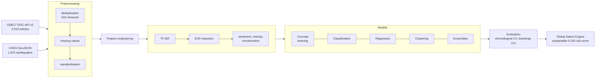
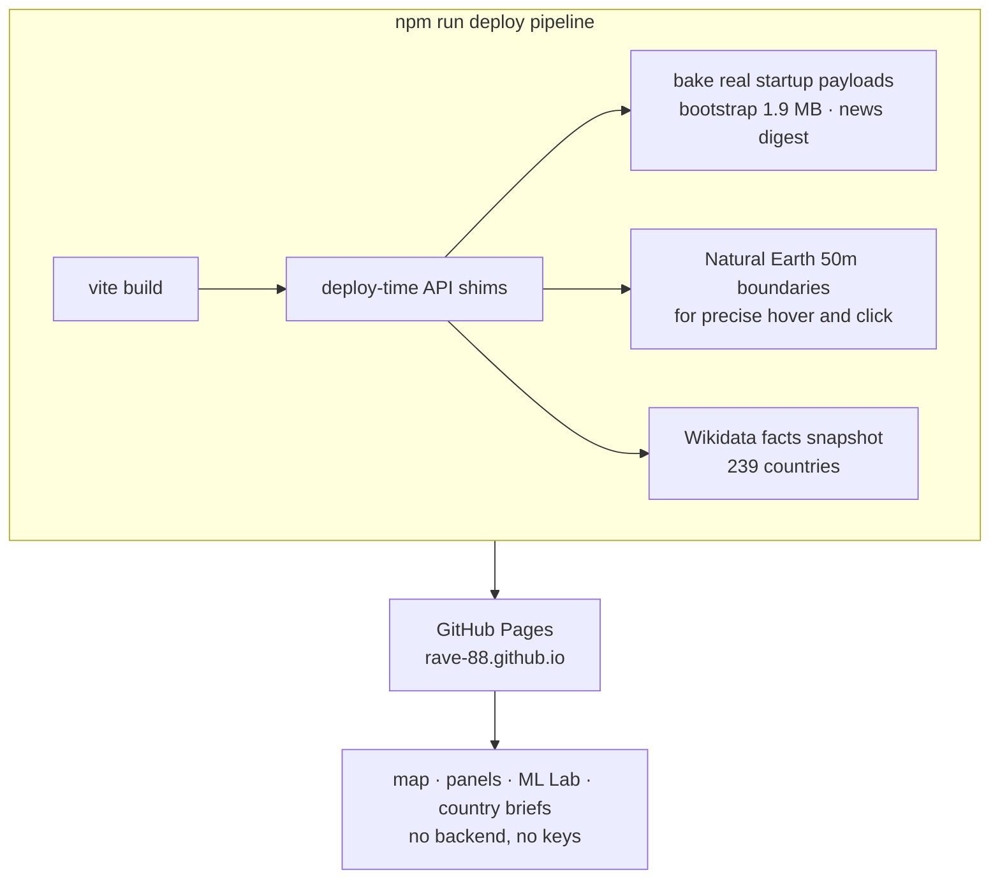

<div align="center">
  

# Global Status Monitoring System

**An ML-powered intelligence platform that watches the pulse of the planet and turns raw world events into risk scores, patterns and predictions.**

[](https://rave-88.github.io/)
[](ml/)
[](ml/)
[](src/)
[](LICENSE)


*Course project for 241AI005 Machine Learning, B.Tech CSE, 5th semester.*

</div>

---

## The story in one paragraph

We wanted our Machine Learning course project to be something you can actually open and use, not just a notebook that prints accuracy once. So we built GSMS: a real time global intelligence dashboard that ingests world news and earthquake feeds, runs a complete machine learning pipeline over that stream, and presents the outcome as interactive maps, an explainable 0 to 100 instability score for every country, and a browser based ML Lab where every model from our syllabus runs live on data that is arriving right now. The same pipeline exists twice, once in Python with scikit-learn for reproducible offline experiments, and once as zero dependency TypeScript running in your browser, so the demo needs no backend and no API keys.

<details>
<summary><strong>The formal abstract (for evaluators)</strong></summary>

> The Global Status Monitoring System (GSMS) is an ML-powered intelligence platform designed to monitor and analyse global events, news, geopolitical conditions, disasters, and infrastructure-related signals. The Machine Learning component of the system applies multiple machine learning techniques to event and news data to identify patterns, classify events, predict impact, and support global risk assessment. The system uses data collected from sources such as news feeds and global event datasets, followed by preprocessing operations including deduplication, missing-value handling, standardization, text processing, TF-IDF feature extraction, dimensionality reduction using SVD, and feature engineering. Various supervised learning algorithms, including Logistic Regression, Linear and RBF Support Vector Machines, Gaussian Naive Bayes, and k-Nearest Neighbors, are implemented for classification tasks. Linear Regression is used for numerical prediction, while K-Means++, Hierarchical Clustering, DBSCAN, and Gaussian Mixture Models are used to discover patterns in event data. Ensemble techniques such as Random Forest, AdaBoost, and Bagging are also implemented to improve prediction robustness. The system evaluates models using metrics such as Accuracy, Precision, Recall, F1-Score, MAE, MSE, RMSE, and R², along with chronological cross-validation and bootstrap confidence intervals. The project demonstrates how machine learning can transform large-scale global event data into meaningful patterns, predictions, and risk indicators, providing a foundation for explainable and data-driven situational awareness.
>
> **Keywords:** Machine Learning, Global Event Monitoring, Geopolitical Risk, Classification, Regression, Clustering, Ensemble Learning, Natural Language Processing, Model Evaluation, Predictive Analysis

</details>

## A 30 second tour


| | |
|---|---|
|  |  |
| **The dashboard.** Live map with conflict zones, quakes, military activity and risk shading, plus streaming panels. | **The country brief.** Click any of 239 countries for its Instability Index, facts, news and context. |


*The Country Instability panel: ranked risk scores with trend arrows, one row per country, refreshed from live signals.*

### What is inside

- **Global Situation map**: 2D WebGL (deck.gl + MapLibre) and a 3D globe (globe.gl + Three.js) with 20+ toggleable intelligence layers (conflict zones, sanctions, nuclear sites, undersea cables, GPS jamming, ship traffic and more), with Natural Earth 50m boundary precision for hover and click.
- **Country Instability Index (CII)**: an explainable 0 to 100 risk score per country, built from published per-country baselines combined with live event signals (unrest, conflict, military activity, information velocity).
- **Streaming panels**: curated live news channels, region news, AI insights, threat timeline, prediction markets, infrastructure cascade across 1,453 links (86 cables, 88 pipelines, 62 ports, 13 chokepoints), and live webcams from geopolitically significant locations.
- **Country briefs for 239 countries**: population, capital, head of state, area, languages and currencies resolved from Wikidata, with Wikipedia summaries, plus per country news and context.
- **The ML Lab**: every model below, running in your browser on live data, tab by tab.

## The machine learning system

One pipeline, two engines. The Python lab is the source of truth for reproducible experiments, and the browser lab mirrors it so the dashboard can score events as they arrive.




### Algorithms, mapped to the syllabus

| Unit | What we built | Where |
|---|---|---|
| Concept learning | Find-S, Candidate Elimination with full version space tracking | `ml/gsms_ml/concept_learning.py` |
| Classification | Logistic Regression, Linear SVM (Pegasos), RBF SVM, Gaussian Naive Bayes, k-NN (k=5) | `ml/gsms_ml/supervised.py` |
| Regression | Linear Regression (Normal Equations) for numeric prediction | `ml/gsms_ml/regression.py` |
| Clustering | K-Means++, Agglomerative (Ward), DBSCAN (k-distance knee), GMM via EM | `ml/gsms_ml/clustering.py` |
| Ensembles | Random Forest, AdaBoost, Bagging with permutation importance | `ml/gsms_ml/ensemble.py` |
| Text | TF-IDF + SVD embeddings, gazetteer NER, lexicon sentiment | `ml/gsms_ml/text.py`, `lexicon.py` |
| Evaluation | Accuracy, Precision, Recall, F1, ROC-AUC, MAE/MSE/RMSE/R², 5-fold chronological CV, bootstrap CIs, bias-variance sweep, regularisation path | `ml/gsms_ml/evaluation.py` |

### Results (all numbers from a real run)

Built from **2,919 raw articles** (2,409 after cleaning, 510 near duplicates removed) and **1,875 earthquakes**, with a strictly future test split (1,686 train / 361 validation / 362 test) and seed 42 pinned everywhere.


| model | accuracy | precision (macro) | recall (macro) | F1 (macro) | 5-fold CV accuracy |
|---|---|---|---|---|---|
| RBF SVM | 0.9890 | 0.3297 | 0.3333 | 0.3315 | 0.9585 ± 0.0000 |
| Linear SVM | 0.9862 | 0.3324 | 0.3324 | 0.3310 | 0.9580 ± 0.0010 |
| k-NN (k=5, distance) | 0.9834 | 0.4972 | 0.4417 | 0.4639 | 0.9541 ± 0.0029 |
| Logistic Regression | 0.9779 | 0.3296 | 0.3296 | 0.3296 | 0.9565 ± 0.0024 |
| Gaussian Naive Bayes | 0.1851 | 0.3345 | 0.3948 | 0.1060 | 0.2991 ± 0.1350 |

The ensembles were evaluated on the same split and take the top spots: **Random Forest 0.9917 accuracy** (0.4986 macro F1), Bagging 0.9890, AdaBoost 0.9862. Full tables in the details below and in the [latest report](ml/results/REPORT.md).

Random Forest also gave us the most useful explanation: `sentiment_score` (0.336), `upper_ratio` (0.191) and `velocity_per_hour` (0.164) dominate, which matches intuition about how breaking news behaves.

<details>
<summary><strong>More results: ensembles, clustering, regression, concept learning</strong></summary>

**Ensembles** (target: derived risk band): Random Forest 0.9917 accuracy / 0.4986 macro F1, Bagging 0.9890, AdaBoost 0.9862.

**Clustering** (silhouette): Agglomerative Ward 0.827, K-Means on 32-dim LSA embeddings 0.754, DBSCAN 0.6895 (eps from the k-distance knee, 4 clusters, 0.4% noise), GMM 0.4586, K-Means++ 0.2808. PCA(2) of the numeric features explains 79.7% of variance.

**Linear Regression** on the derived risk score: MAE 5.08, RMSE 8.20, with interpretable standardised coefficients (sentiment −3.00, word count +1.64, corroboration +1.23).

**Bootstrap**: Logistic Regression test accuracy 0.9779, 95% CI [0.9641, 0.9917] over 200 resamples.

**Concept learning**: over 2,919 discretised rows (28 positives for `high_risk`), Find-S converges to the most specific hypothesis `alert_level = high, breaking = 0` (everything else generalised), and Candidate Elimination collapses to a single S/G boundary pair with 0 noisy examples.

</details>

We care about honest evaluation, so the test set is strictly in the future relative to training (no leakage), cross-validation folds are chronological rather than random, and the report shows the ugly numbers next to the good ones.


<details>
<summary><strong>The regularisation path (why the flat curves are a good sign)</strong></summary>

| C | train accuracy | test accuracy | gap |
|---|---|---|---|
| 0.001 | 0.9585 | 0.9862 | −0.0277 |
| 0.01 | 0.9580 | 0.9834 | −0.0254 |
| 0.1 | 0.9585 | 0.9862 | −0.0277 |
| 1.0 | 0.9580 | 0.9862 | −0.0282 |
| 10 | 0.9580 | 0.9862 | −0.0282 |
| 100 | 0.9580 | 0.9862 | −0.0282 |

The tiny, stable gap across five orders of magnitude of C tells us the model is variance-tolerant on this feature space: the TF-IDF + SVD representation is doing the regularisation work for us.

</details>

### The browser ML Lab

The ML Lab panel runs the entire pipeline in Web Workers, no server, no Python, no keys: pick the live stream or the embedded sample dataset, and every tab (Overview, Dataset, Classification, Regression, Clustering, Ensembles, Evaluation, Concept Learning) computes on the spot. The repo also ships a committed pytest suite for the Python lab (`ml/tests/`), so the algorithms are checked in both worlds.

## How it is deployed

The interface is a static build on GitHub Pages, and a small deploy-time pipeline layers real data on top of it (source code stays untouched):



At runtime, a tiny interceptor composes per-country facts in the visitor's browser, while the heavier startup payloads ship as baked snapshots. On any serverless deployment the genuine API functions shadow the static files automatically.

## Running it

**The dashboard (interface + live ML Lab):**

```bash
npm install
npm run dev
```

Open http://localhost:3006/, then the menu, **Intelligence → ML Lab**. Everything works with zero environment variables; GDELT and USGS are keyless.

**The Python ML Lab (reproducible pipeline):**

```bash
cd ml
python3 -m venv venv && source venv/bin/activate
pip install -r requirements.txt
python run_all.py            # full pipeline → ml/results/REPORT.md + 9 JSON files
python -m pytest tests/ -v   # algorithm test suite
```

## Repository structure

```
├── ml/                     Python ML Lab
│   ├── gsms_ml/            preprocess · supervised · regression · clustering
│   │                       ensemble · concept_learning · evaluation · status_engine
│   ├── data/               GDELT + USGS datasets (CSV)
│   ├── results/            REPORT.md + JSON metrics from the latest full run
│   └── tests/              pytest suite for every algorithm family
├── src/                    Dashboard app (panels, dual map, ML Lab UI, workers)
├── shared/                 Isomorphic ML cores shared by both engines
├── docs/                   ml-project.md · ml-syllabus-mapping.md · APP-README.md
├── scripts/                deploy-time shim + snapshot generators
└── api/                    Serverless endpoints for self-hosted deployments
```

## Tech stack

| Layer | Tools |
|---|---|
| Machine learning | scikit-learn 1.5, NumPy, pandas, SciPy, Transformers.js (MiniLM, DistilBERT, BERT NER) |
| Frontend | Vanilla TypeScript, Vite, globe.gl + Three.js, deck.gl + MapLibre GL |
| Desktop | Tauri 2 (Rust) with a Node.js sidecar |
| Deployment | GitHub Pages, deploy-time snapshots, service worker + PWA |

## Documentation

- [ML technical documentation](docs/ml-project.md), the full implementation write-up
- [Syllabus mapping guide](docs/ml-syllabus-mapping.md), traceability from every 241AI005 topic to code
- [Latest lab report](ml/results/REPORT.md), generated output of a complete pipeline run
- [App README](docs/APP-README.md), the underlying platform documentation

## Team

| Roll number | Name |
|---|---|
| 24B11CS489 | **Viswajeet** |
| 24B11CS357 | **Priyamwda Rai** |
| 24B11CS461 | **Satya Sri Hema** |
| 24B11CS256 | **Uma Ram Charan** |

*241AI005 Machine Learning, B.Tech CSE, 5th semester. Built over one semester of late nights, real datasets and a lot of learned lessons about what "just a demo" really means.*

## License and attribution

Source licensed **AGPL-3.0-only** (see [LICENSE](LICENSE)). The dashboard platform is built on the open source [WorldMonitor](https://github.com/koala73/worldmonitor) codebase by Elie Habib, and the ML system (the Python lab, the browser ML Lab, the status engine and the deployment pipeline) was developed by this team on top of it.

---

<div align="center">
  <sub>Global Status Monitoring System, machine learning for a world that does not stop generating events.</sub><br/>
  <a href="https://rave-88.github.io/">live interface</a> · <a href="https://github.com/RAVE-88/global-status-monitoring-system">repository</a> · <a href="ml/results/REPORT.md">latest report</a>
</div>
